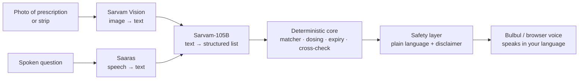

# Med Assistant

**Read, understand and verify medicines — by voice, in your language.**

Point a phone or laptop camera at a handwritten prescription or a medicine strip.
Med Assistant reads it, speaks it back in **Telugu, Hindi or English**, and
**cross-checks the strip in your hand against your prescription** — warning you if
a tablet is wrong, missing, or expired.

Built on Sarvam's India-made AI stack for **Sarvam Campus '26 × IIIT Hyderabad**.

> Reads and matches only. **Not medical advice.**

---

## The story: how we got here

We started somewhere else entirely — reading textbooks aloud for blind students.
Then we found that tools like Kibo already read printed text well, so we asked a
sharper question: **where does *not being able to read* actually hurt someone's
body?** The answer kept coming back to one place — **medicines**.

What we found:

- In one survey, **89% of visually impaired people could not read their medicine
  labels.** They are holding the right information and still cannot reach it.
- In a **hospital study in Goa**, blind patients were found to tell their medicines
  apart **only by the shape of the box** — and missed doses when two boxes felt the
  same. There was no talking label, no Braille, no one on hand to read it to them.
- Prescriptions in India are almost always **handwritten**, often in English the
  patient or caretaker reads poorly, using shorthand (`1-0-1`, `BD`, `TDS`, `a/f`)
  that only medical staff understand.
- India's response so far doesn't scale: the drug regulator has only *proposed*
  audio QR codes, a petition for Braille labels is pending in the Supreme Court,
  and one doctor in Bengaluru has hand-made a few dozen Braille prescriptions by
  herself.

And a quiet twist tied it together: **diabetes is a leading cause of blindness in
India**, and diabetics take the most daily pills. The people most likely to lose
their sight are the ones juggling the most medicines.

So the problem isn't "blind people can't see." It's that **a prescription holds
information the person can't extract** — because they can't see it, can't read the
handwriting, or don't know the shorthand. That single problem is what Med Assistant
solves, for three kinds of people at once.

---

## Who it's for

The same engine, three tailored faces:

| User | Their barrier | What they get |
|---|---|---|
| **Patient** (low-vision) | Can't see it | Everything spoken, voice-driven, guided capture |
| **Caretaker / Nurse** | Handwriting + language | A clear schedule in their language, and a dose log |
| **Common person** | Medical jargon | A plain-language schedule in ten seconds |

**We built it accessibility-first on purpose.** A blind person can't use a dense
visual dashboard — but a sighted nurse can use a simple, spoken, high-contrast
interface perfectly well. Designing for the hardest user serves everyone else for
free.

---

## How people use it

Open the app, choose **who you are**, pick your language, and:

1. **Show the prescription** — point the camera or drop a photo/PDF. It reads the
   medicines and schedule aloud:
   *"Four medicines. Dolo 650 — one in the morning, one at night, after food, for
   five days…"* — and remembers it.
2. **Check a tablet** — point at a strip and hear one of:
   - **On your prescription** — with when to take it.
   - **Not on your prescription** — check with your doctor.
   - **Expired** — do not use it.
   - **Couldn't read it clearly** — turn it over and hold steady. *(Never a guess.)*
3. **Ask by voice** — *"Which tablet at night?"* — answered from your own
   prescription.
4. **Dose log** — record what was taken or given, so a doctor or family member can
   verify later. For a blind patient with no caretaker, that record is a safety net.

There's also optional **voice navigation** — say "patient", "nurse" or "general"
to move between modes hands-free — and a top-right **credits meter** showing the
estimated Sarvam spend for the session.

---

## The models we used (all Sarvam)

Med Assistant uses four Sarvam models, covering every pillar of the event theme —
document intelligence, AI agents, multilingual AI, and voice AI.

| Step | Sarvam model | Theme pillar |
|---|---|---|
| Read the image → text (handwriting too) | **Sarvam Vision** (Document AI) | Document intelligence |
| Clean the text into a structured medicine list; answer questions | **Sarvam-105B** (`sarvam-105b-conversations`) | AI agents |
| Phrase the result in the user's language | **Sarvam-105B** (or Mayura translate) | Multilingual AI |
| Speak it aloud | **Bulbul** (text-to-speech) | Voice AI |
| Hear the spoken question | **Saaras** (speech-to-text) | Voice AI |

Because the stack is **hosted in India**, prescriptions — which are health data —
stay in-country, a real advantage under India's DPDP Act.

**Verified live:** Sarvam Vision read a real, messy, handwritten prescription and
Sarvam-105B structured it end to end during the build.

---

## How we built it

The core idea that makes a medicine app trustworthy: **the AI reads, but ordinary
code verifies.** Vision and 105B do the *reading* and *tidying*, but they are never
the final word — every medicine is then checked against a list of real Indian drugs.



What the deterministic core (no AI) guarantees:

- **OCR noise is corrected** — "Doio 65O" resolves to **Dolo 650**.
- **Invented drugs are refused** — if nothing matches a real medicine, it is not
  passed on.
- **Low confidence is admitted, never guessed** — *"I couldn't read this, please
  show it again."* For a medicine app, that is the correct behaviour.

### Project layout

```
app/
  config.py            one switch: MODE = mock | sarvam
  main.py              FastAPI backend
  providers/
    base.py            the 5-method interface (the seam)
    mock.py            runs offline, no keys (canned data)
    sarvam.py          the single file that talks to Sarvam
  core/                deterministic brain, fully tested
    dosing.py          1-0-1, 1/0/1, BD, TDS, a/f, x5d → schedule
    medicines.py       fuzzy-match against real Indian drugs
    prescription.py    raw text → validated medicine list
    crosscheck.py      strip vs prescription → verdict
    safety.py          plain-language output in en / hi / te
    usage.py           Sarvam credit / spend meter
    log.py             dose record
  static/              the three-mode web UI
tests/                 16 tests, all green
```

**The seam is the whole trick.** Everything model-shaped lives behind
`providers/`. In mock mode the app runs fully offline for rehearsal; flip one
setting and the same code calls the real Sarvam models. Nothing else changes, so
the app can never crash for a missing key.

---

## Running it

**Quick start (mock mode — no keys, fully working):**
```bash
git clone https://github.com/saix0x0/med-assistant
cd med-assistant
bash run.sh
```
Open **http://localhost:8000** (or **:8077** if 8000 is busy). Needs Python 3.9+.
The script makes its own virtualenv and installs everything on first run — no key
needed; it runs in mock mode. Camera and microphone work because it's `localhost`.

If you'd rather run it by hand:
```bash
python3 -m venv .venv
.venv/bin/pip install -r requirements.txt
.venv/bin/python -m uvicorn app.main:app --port 8077
```

**Run the tests:**
```bash
.venv/bin/python -m pytest -q
```

**Go live on Sarvam:**
```bash
printf 'SARVAM_API_KEY=your_key_here\nMODE=sarvam\n' > .env   # gitignored
.venv/bin/python hello_sarvam.py                              # proves the key
.venv/bin/python -m uvicorn app.main:app --port 8077
```
Without a key it stays in mock mode automatically — nothing breaks.

> Camera and microphone work on `localhost` or real HTTPS only; browsers block
> them on a plain `http://<ip>` address.

---

## Honest limitations

- It **reads and matches only** — never medical advice; the disclaimer is spoken.
- English doctor-scrawl can be hard for any reader; when unsure, the app **says so**
  instead of guessing.
- Niche medicine brands resolve best with the full Indian-medicine dataset dropped
  in at `app/data/indian_medicines.csv`; a small seed list ships in the repo.
- The dose log is in-memory for the demo (a real build stores it per patient).

---

## Acknowledgements

Built for **Sarvam Campus '26 × IIIT Hyderabad**, on Sarvam's AI platform —
Sarvam Vision, Sarvam-105B, Bulbul and Saaras.

Deeper write-up: [`REPORT.md`](REPORT.md)
