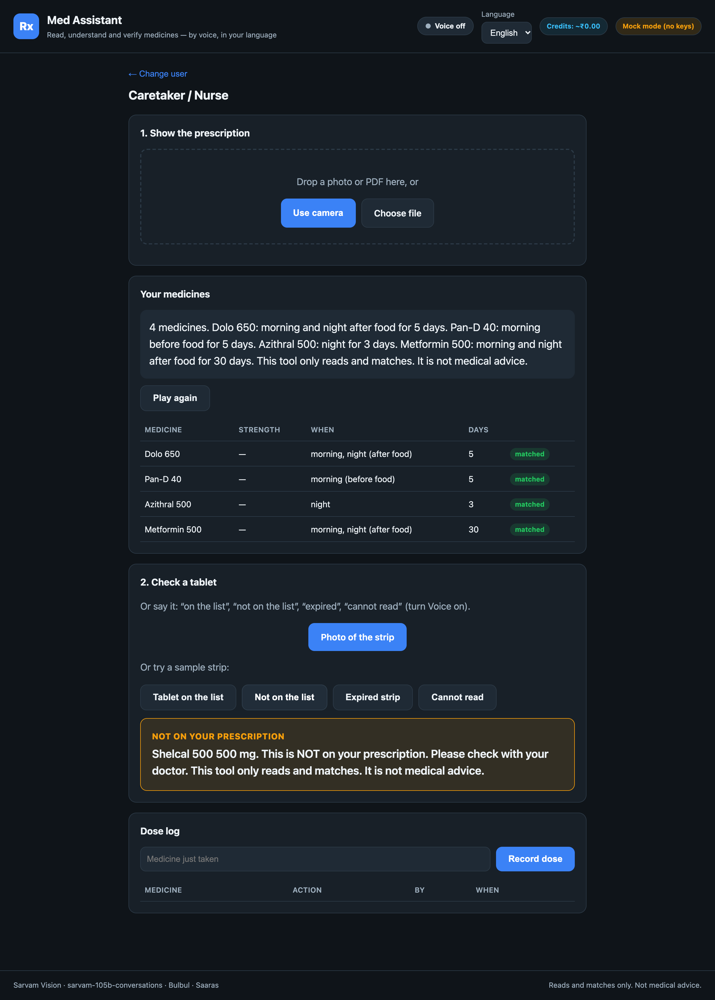
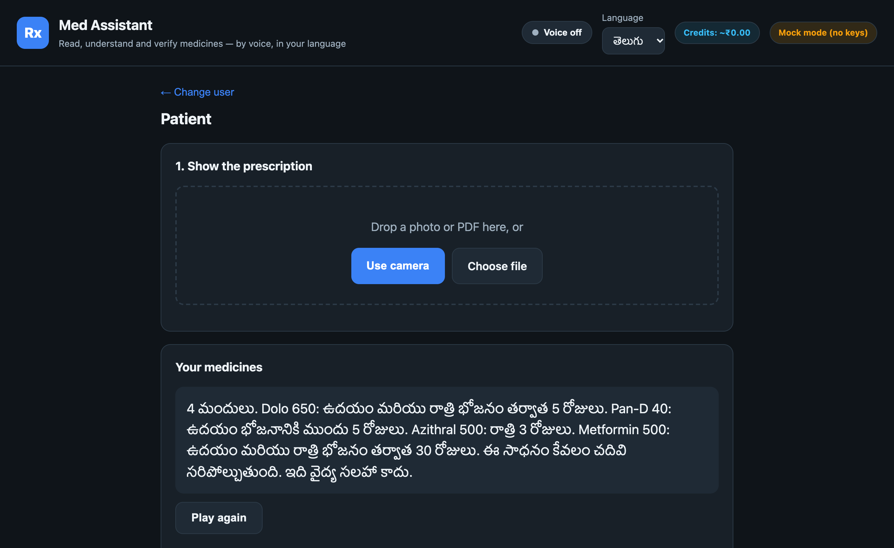
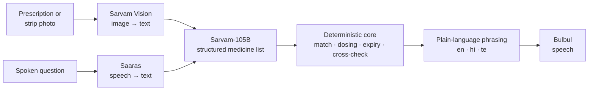

<div align="center">

# Med Assistant

**Read, understand and verify medicines by voice, in Telugu, Hindi or English.**

[](https://github.com/saix0x0/med-assistant/actions/workflows/ci.yml)


[](LICENSE)

Built in a 45-minute build-along at **Sarvam Campus '26 × IIIT Hyderabad**<br>
on Sarvam Vision · Sarvam-105B · Bulbul · Saaras

</div>

<p align="center">
  
</p>

Med Assistant reads a handwritten prescription, speaks the schedule back in the
user's language, and **checks whether the medicine strip in their hand is
actually on that prescription**. A wrong, missing or expired tablet is caught
before it is taken.

---

## Why this exists

A prescription holds information many people cannot get at. They can't see it,
can't read the handwriting, or don't know the shorthand.

- **89% of visually impaired respondents** in one survey could not read their
  prescription labels; a hospital study found blind patients telling medicines
  apart by the shape of the box.
  ([1](https://doaj.org/article/486a409c56a345988c42cd8fcc9d8b83), [2](https://www.ijcmph.com/index.php/ijcmph/article/view/2562))
- **Indian prescriptions are handwritten in clinical shorthand.** `1-0-1`, `BD`,
  `TDS`, `a/f`, `x5d` are clear to a pharmacist and opaque to most patients and
  family caretakers.
- **The people losing their sight take the most medicines.** About 1 in 6 Indian
  diabetics has diabetic retinopathy, a leading cause of blindness.
  ([3](https://dspace.uohyd.ac.in/handle/1/6687))

## The idea

Existing tools read *one* thing: a label, a page or a strip. Med Assistant
connects the two that matter, **the prescription and the medicine in your hand**,
and says in plain words whether they agree.

| | Reads text aloud | Reads handwritten prescriptions | Indian languages by voice | Checks strip against prescription |
|---|:-:|:-:|:-:|:-:|
| Pharmacy talking labels (CVS Spoken Rx, ScripTalk) | ✓ | | | |
| General readers (Kibo, Google Lookout) | ✓ | partial | ✓ | |
| Strip readers (SnapMed, research prototypes) | ✓ | | partial | |
| **Med Assistant** | ✓ | ✓ | ✓ | ✓ |

Three principles shape the design:

- **The AI reads; plain code verifies.** Sarvam models turn images and speech into
  text. Every decision after that (which medicine, what dose, expired or not, on
  the list or not) is made by deterministic, unit-tested code.
- **Never invent a medicine.** OCR noise like `Doio 65O` resolves to **Dolo 650**
  through fuzzy matching against known Indian medicines. A name that matches
  nothing is reported as unreadable, never guessed.
- **Design for the hardest user.** Built voice-first for a blind patient; the same
  spoken, high-contrast interface works just as well for a nurse or a family
  member.

## Three users, one engine

| Mode | For | What it does |
|---|---|---|
| **Patient** | Low-vision and blind users | Speaks the prescription, answers questions by voice ("Which tablet at night?"), keeps a dose log |
| **Caretaker / Nurse** | Anyone giving medicines to a patient | Shows the schedule, **checks a strip photo against the prescription**, records every dose given |
| **Quick read** | Anyone holding a prescription | A plain-language schedule in seconds |

Every strip check ends in one of four spoken verdicts: **on your prescription**
(with when to take it), **not on your prescription**, **expired**, or **could not
read clearly, show it again**.

<p align="center">
  
</p>

Voice control switches modes hands-free ("patient", "nurse", "general"), and a
live meter shows the estimated Sarvam spend (₹) for the session.

## How it works



| Stage | Component | Responsibility |
|---|---|---|
| Read | **Sarvam Vision** | Printed and handwritten prescriptions and strips to raw text |
| Structure | **Sarvam-105B** | Raw text to a medicine / strength / dose list; answers questions |
| Validate | `core/medicines.py` | Fuzzy-matches every name against known Indian medicines; refuses unknowns |
| Schedule | `core/dosing.py` | `1-0-1` `1/0/1` `OD` `BD` `TDS` `QID` `HS` `SOS` `a/f` `b/f` `x5d` to a daily schedule |
| Verify | `core/crosscheck.py` | Strip name, strength and expiry against the prescription: four verdicts |
| Speak | `core/safety.py` + **Bulbul** | One short sentence in the user's language |
| Listen | **Saaras** | Spoken questions to text |

Prescriptions are health data. Sarvam's stack is hosted in India, so that data
stays in the country, in line with India's DPDP Act.

### One seam for every model

All model calls sit behind a single provider interface
([`app/providers/base.py`](app/providers/base.py)) with two implementations:

```
Provider: read_document · read_strip · assist_extract · answer · speak · transcribe
├── MockProvider    offline, deterministic, no keys
└── SarvamProvider  Sarvam Vision, Sarvam-105B, Bulbul, Saaras
```

`MODE=mock` or `MODE=sarvam` picks one. No other file changes, and a failed API
call falls back instead of crashing the app.

## Built in 45 minutes

The API keys were handed out at the event and the build window was 45 minutes.
We treated that as an integration problem and moved everything else earlier.

**Before the event**
- Researched the problem space and existing tools to confirm the
  strip-to-prescription check was unsolved.
- Built the full product against the provider interface, running on the mock
  provider: backend, three-mode UI, voice control, dose log.
- Wrote and tested the deterministic core: dosing parser, medicine matcher,
  cross-check and multilingual phrasing.

**In the 45 minutes**
- Switched `MODE=sarvam`; only [`app/providers/sarvam.py`](app/providers/sarvam.py)
  talks to the Sarvam SDK.
- Tested Sarvam Vision on real handwritten prescriptions first, then wired
  Sarvam-105B, Bulbul and Saaras.
- Tuned parsing against live output (Vision's text format, `1/0/1`-style dosing)
  and added per-call usage tracking.
- Verified end to end: a real handwritten prescription read by Sarvam Vision,
  structured by Sarvam-105B and spoken back.

## Run it

Requires Python 3.10+.

```bash
git clone https://github.com/saix0x0/med-assistant.git
cd med-assistant
bash run.sh
```

Open **http://localhost:8077**. The first run sets up a virtual environment.
Without an API key the app runs on the mock provider, so every screen works
offline.

**Live Sarvam models:** copy `.env.example` to `.env` and set

```env
SARVAM_API_KEY=your_api_key
MODE=sarvam
```

then check the connection and start the app:

```bash
.venv/bin/python -m scripts.hello_sarvam
bash run.sh
```

To run Vision on your own prescription photo:
`MODE=sarvam .venv/bin/python -m scripts.smoke_sarvam path/to/prescription.jpg`

**Tests:** `.venv/bin/python -m pytest -q`

## Repository layout

```
app/
├── main.py            FastAPI routes: scan, strip, ask, transcribe, log, usage
├── config.py          the single MODE switch and model IDs
├── providers/         the model seam: base interface, mock, Sarvam
├── core/              deterministic logic: dosing, matching, cross-check, phrasing
├── data/              seed list of common Indian medicines
└── static/            three-mode web interface
scripts/               live Sarvam connectivity checks
tests/                 unit tests for the core
docs/                  design notes and screenshots
```

A longer, plain-language walkthrough is in [`docs/design.md`](docs/design.md).

## Responsible use

Med Assistant is an accessibility aid that reads and matches. It does not give
medical advice, and every spoken result says so. Medicine decisions belong with a
doctor or pharmacist.

## License

[MIT](LICENSE) © 2026 Siddhanth Challa
