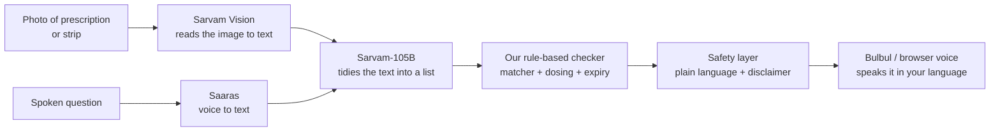

# Med Assistant — Project Report

**Sarvam Campus '26 × IIIT Hyderabad — Build-along submission**
*Read, understand and verify medicines — by voice, in your language.*

> This report is written to be read by anyone — whether or not you know machine
> learning. Technical readers get the architecture and the model wiring; everyone
> else gets a plain-language account of what the product does and why it matters.

---

## 1. In one paragraph

Millions of Indians cannot read their own medicines — some because they can't
see, many more because the prescription is handwritten, in a language or in
medical shorthand they don't understand. **Med Assistant** points a phone
(or laptop) camera at a prescription or a medicine strip, reads it, and **speaks
it back in the person's own language (Telugu / Hindi / English)**. Its unique
step: it **cross-checks the strip in your hand against your prescription** and
warns you if the medicine is wrong or expired. It is built entirely on Sarvam's
India-made AI stack.

---

## 2. The problem (plain language)

A prescription is useless to you if you can't read it. That happens to three
kinds of people:

- **People who can't see.** In one survey, **89% of visually impaired
  respondents could not read their medicine labels.** In a Goa hospital study,
  blind patients told their medicines apart *by the shape of the box* — and
  missed doses. India has no standard talking-label or Braille-label system; the
  drug regulator has only *proposed* audio QR codes, and a Supreme Court petition
  for Braille labels is still pending.
- **Nurses and caretakers.** A doctor's prescription is usually handwritten, often
  in English the caretaker reads poorly, using shorthand (`1-0-1`, `BD`, `TDS`)
  that only medical staff know. Giving the wrong medicine or the wrong dose is a
  real, documented harm.
- **Ordinary people** managing their own or a parent's medicines, who can see and
  read but don't know that `1-0-1 a/f` means "one in the morning and one at night,
  after food."

The common thread: **the information is there, but the person holding it cannot
extract it.** That is the single problem this product solves.

---

## 3. Who it is for — three users, one tool

| User | Their barrier | What they get |
|---|---|---|
| **Patient (low-vision)** | Can't see it | Everything spoken; voice-driven; guided camera |
| **Caretaker / Nurse** | Handwriting + language | Clear schedule in their language; a dose log |
| **Common person** | Medical jargon | Plain-language schedule in ten seconds |

**Design principle: build accessibility-first.** A blind person cannot use a
dense visual dashboard, but a sighted caretaker can use a simple, high-contrast,
spoken interface perfectly well. So the hardest user (the blind patient) defines
the design, and the others are served for free. The app presents three tailored
"modes," but they are three skins over **one shared engine**.

---

## 4. What it does — the features

1. **Scan prescription** → read the medicines and schedule aloud, in your
   language: *"Four medicines. Dolo 650 — morning and night, after food, for five
   days…"* and remember it.
2. **Check a tablet** → point at a strip → one of four spoken verdicts:
   - **On your prescription** — with when to take it.
   - **Not on your prescription** — check with your doctor.
   - **Expired** — do not use it.
   - **Could not read** — turn it over and hold steady. *(Never a guess.)*
3. **Ask by voice** — *"Which tablet at night?"* — answered from your own
   prescription.
4. **Dose log** — a record of what was taken or given, so a doctor or family
   member can verify later. For a blind patient with no caretaker, this record is
   a safety net.

---

## 5. How it works — the AI, explained for everyone

Think of it as an **assembly line**. The image goes in one end; a spoken,
checked schedule comes out the other. Each station does one job.



**The key idea for non-technical readers:** the two AI models (Vision and 105B)
do the *reading* and *tidying*, but they are **not trusted to be the final
word**. After them, ordinary, predictable computer code (station D) checks every
medicine name against a list of real Indian medicines. So:

- If the AI mis-reads *"Dolo 650"* as *"Doio 65O"*, the checker still recognises
  it as **Dolo 650**.
- If the AI tries to invent a medicine that doesn't exist, the checker **refuses
  it** rather than passing it on.
- If nothing matches, the app **says it couldn't read** instead of guessing.

This is what makes a medicine app safe: the unpredictable part (AI) is always
followed by a predictable safety net (rules).

---

## 6. The Sarvam models used — and how we align with the event

The event theme is: *multilingual AI, voice AI, document intelligence, AI agents.*
This project uses **all four**:

| Step in the assembly line | Sarvam model | Theme pillar it hits |
|---|---|---|
| Read the image → text | **Sarvam Vision** (Document AI, `handwritten`/`printed`) | Document intelligence |
| Tidy text → structured medicine list; answer questions | **Sarvam-105B** (chat, JSON mode) | AI agents |
| Translate / phrase in the user's language | **Sarvam-105B** (or Mayura translate) | Multilingual AI |
| Speak the result | **Bulbul** (text-to-speech) | Voice AI |
| Hear the spoken question | **Saaras** (speech-to-text) | Voice AI |

Built on the **Sarvam SDK** (`sarvamai`) and designed to run on the **Sarvam /
Indus** stack. Because it is an India-hosted stack, health data (prescriptions)
stays in-country — a genuine advantage under India's DPDP Act, worth stating in
the pitch.

---

## 7. The skeleton — how the code is laid out

```
sarvam-medguard/
├── app/
│   ├── config.py            # one switch: MODE=mock | sarvam
│   ├── main.py              # FastAPI backend (6 endpoints)
│   ├── providers/           # THE SEAM between our app and Sarvam
│   │   ├── base.py          #   the 5-method interface
│   │   ├── mock.py          #   runs today, no keys (canned results)
│   │   └── sarvam.py        #   the ONE file we finish at the event
│   ├── core/                # deterministic brain — no AI, fully tested
│   │   ├── dosing.py        #   1-0-1, BD, TDS, a/f, x5d → structured schedule
│   │   ├── medicines.py     #   fuzzy-match against real Indian-medicine list
│   │   ├── prescription.py  #   raw text → validated medicine list
│   │   ├── crosscheck.py    #   strip vs prescription → verdict
│   │   ├── safety.py        #   plain-language text in en/hi/te + disclaimers
│   │   └── log.py           #   dose record
│   ├── data/                # seed medicine list + mock prescription
│   └── static/              # the three-mode web UI (HTML/CSS/JS)
└── tests/                   # 15 tests, all green; + smoke_sarvam.py for event day
```

**Why this shape matters for a 60-minute build-along:** everything except
`providers/sarvam.py` is already built and tested. On event day the entire task
is: paste the key, flip the switch, and fill in (or confirm) that one file. All
three modes light up at once because they share the same engine.

---

## 8. The one real risk — handwriting — and how we handle it

Sarvam Vision supports a `handwritten` mode and confirms **Indian-language**
handwriting. It does **not** explicitly claim **English** handwriting — and most
Indian prescriptions are handwritten in English (drug names are English). Classic
illegible doctor-scrawl is the hardest possible case.

We do not pretend otherwise. The design assumes Vision's output is noisy and
recovers in three layers (Vision → 105B clean-up → rule-based matcher), and when
confidence is low the app **says so** instead of guessing — which, for a medicine
app, is the correct behaviour. For the live demo we use a legibly written
prescription and keep one genuine scrawl as an honest "hard case."

**This is the first thing we test the moment we receive the API key**
(`tests/smoke_sarvam.py`), before wiring anything else.

---

## 9. Build plan for the event (how the 60 minutes are spent)

The framework in this repo is **Phase 1, already done**. The event is Phase 2.

1. **(5 min) Smoke-test Vision first** — `MODE=sarvam python tests/smoke_sarvam.py photo.jpg`.
   Confirm handwriting reads. This de-risks everything.
2. **(20 min) Wire `providers/sarvam.py`** — it is already written to the SDK;
   confirm each of the 5 methods returns real data, adjust the two prompts.
3. **(15 min) Tune extraction** — check 105B's medicine list on 2–3 real photos.
4. **(10 min) Optional Bulbul voice** — set `TTS_PROVIDER=bulbul` for natural Telugu.
5. **(10 min) Rehearse the 90-second demo**, record a backup run in case Wi-Fi dies.

---

## 10. 90-second demo script

1. "Who is using this?" → choose **Patient**.
2. Drop a prescription PDF → the app **speaks it in Telugu** and lists the meds.
3. Show a strip that **isn't** on the prescription → hear the warning.
4. Show an **expired** strip → hear "do not use it."
5. Ask by voice, *"Which tablet at night?"* → it answers from the prescription.
6. One line: *"Same tool, three users — the blind patient, the nurse, the family
   member — all on Sarvam's India-made stack."*

---

## 11. Honest limitations

- Reads and matches only — **never medical advice**; the disclaimer is spoken.
- English doctor-scrawl may fail; the app admits it rather than guessing.
- Cut strips can lose the name/expiry — reported, not invented.
- The dose log is in-memory for the demo (a real build stores it per patient).

---

## 12. Status right now

- Full framework built and running on a laptop in **mock mode** — no keys needed.
- **15/15 tests pass**; the three-mode UI is verified end-to-end.
- Telugu / Hindi / English output works today (browser voice + templated phrasing).
- Only `providers/sarvam.py` awaits the live key — exactly as planned.

*Reads and matches only. Not medical advice.*
